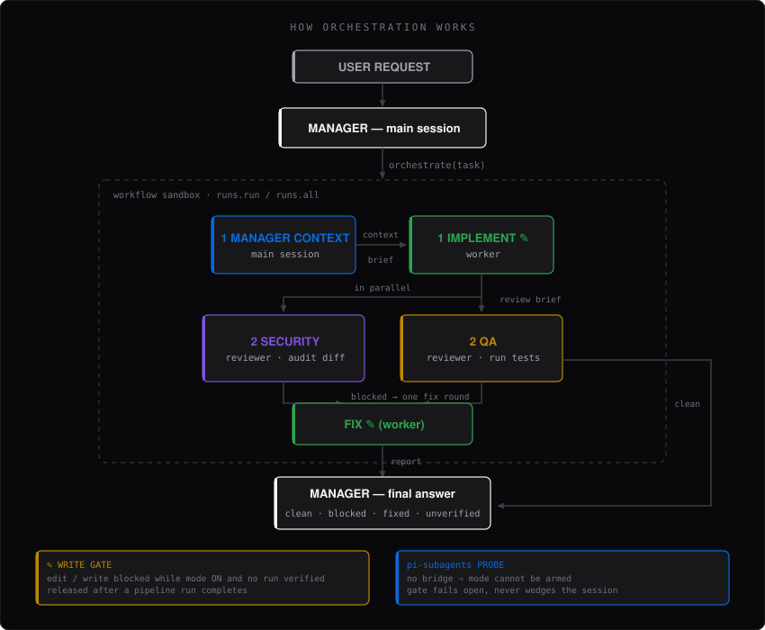

<h1 align="center">pi-orchestrator</h1>

<p align="center">
  <em>Role-based orchestration extension that forces the Pi Coding Agent to delegate through subagents instead of skipping them.</em>
</p>

<p align="center">
  
  
  
  
</p>

<p align="center">
  
</p>

---

## Overview

**pi-orchestrator** is a Pi Coding Agent extension that turns delegation from a *suggestion* into *enforced routing*.

A rule written in `AGENTS.md` is soft context: the main model may read it and still decide to do everything itself. This extension closes that gap with three layers — a system-prompt rule injected for an explicitly submitted task, a hard `orchestrate` tool that runs the whole pipeline itself, and a tool-call gate that blocks the manager from writing code while the pipeline owns the change.

### Features
- **Per-task command:** `/orchestrator <prompt>` runs one task; ordinary chat stays unaffected. Settings persist, activation does not.
- **Four Configurable Roles:** Context engine, lead coder, security specialist, and QA — each with its own model and thinking level.
- **Enforced Pipeline:** `orchestrate` runs research → implement → security + QA in parallel → at most one fix round, and returns one consolidated report.
- **Write Gate:** During an orchestrator task and no verified pipeline run has completed, `edit`, `write`, and direct `worker` launches are blocked at the tool-call boundary.
- **Searchable Model Picker:** Pi's default selector renders every option without scrolling, so long model lists get clipped. The picker in this extension scrolls, filters as you type, and returns to the menu after a pick.
- **Tab-Cycling Rows:** `Tab` cycles the focused row — toggle optional stages or step through thinking levels without leaving the menu.
- **Fail-Open on Misconfiguration:** A broken `pi-subagents` bridge releases the gate instead of wedging the session.
- **Child-Process Guard:** Subagent children spawn their own Pi process; the extension detects `PI_SUBAGENT_CHILD` and stays inert there.
- **Dependency Gate:** `pi-subagents` is required and checked when the command is used. No startup probes or global activation.

---

## How It Works



The manager does not run the stages itself: it calls `orchestrate(task)`, and the whole sequence executes inside the tool. Each stage's output is handed to the next, so later stages can only reason about work that actually happened.

- **Stages 1-2 are sequential.** The codebase scout produces a brief; the coder implements from it.
- **Stage 3 is parallel.** Both reviewers receive the same brief and run concurrently.
- **The fix round is conditional and hardcoded to one pass.** A `blocked` verdict buys exactly one repair; there is no re-review afterwards, and no retry loop.
- **A dead reviewer is not a clean reviewer.** A reviewer that fails, lacks evidence, or returns no valid verdict makes the result `unverified`. Infrastructure failures alone never launch a speculative code fix.

If both reviewers pass and both upstream stages succeeded, the change was never at risk of being fixed blindly — the manager gets a `clean` verdict and answers.

---

## Architecture

| Role | Default Agent | Stage | Responsibility |
|:---|:---|:---|:---|
| **Manager** | *main session* | routes + accepts | Picks the models, hands off the task, synthesizes the report, makes the final call without post-review source edits. |
| **Context engine** | `scout` | 1 | Gathers the files, facts, and constraints. Read-only. |
| **Lead coder** | `worker` | 2 | Implements from that context. The only writer. |
| **Security specialist** | `reviewer` | 3 | Audits the diff for injection, authorization, secrets, and unsafe input handling. |
| **QA** | `oracle` | 3 | Runs the tests and reports pass/fail evidence. Needs an exec-capable agent (`bash`); a read-only reviewer can only inspect, so it would return `blocked` for the unverified re-run. |

Stages 3 run **in parallel**; concrete blockers from valid reviewers buy at most one fix round before the final answer.

---

## Enforcement Layers

1. **System prompt (advisory).** For the command-submitted task, `before_agent_start` appends the pipeline rules to `systemPromptOptions.promptGuidelines`.
2. **`orchestrate` tool (structural).** The whole staged fan-out runs inside the tool, so the manager cannot forget the sequence — there is nothing to remember.
3. **`tool_call` gate (hard).** `edit`, `write`, and direct `worker` launches are rejected until a pipeline run reports explicit success.

> This is a routing guard, not a security sandbox: shell writes, nested workflows and other delegation tools are not comprehensively intercepted. Prompts explicitly forbid bypasses, but OS/tool isolation would be needed for a hard security boundary.

> The gate deliberately fails **closed** on ambiguous completion payloads (editing stays blocked) and **open** when the RPC bridge is unavailable (editing is released).

---

## Installation

Install it as a **Pi package**: Pi clones the repo, reads the manifest, and loads the extension.

```bash
pi install git:github.com/andrraa/pi-orchestrator
```

Pin a revision when you want a frozen checkout (git tags and commits are pinned; untagged installs follow the default branch):

```bash
pi install git:github.com/andrraa/pi-orchestrator@v0.1.0
```

Or install from a local clone while developing:

```bash
pi install ./pi-orchestrator
```

### Managing the package

```bash
pi list                                   # confirm it is registered
pi update --extensions                    # reconcile the checkout
pi remove git:github.com/andrraa/pi-orchestrator
```

The declaration is written to `~/.pi/agent/settings.json`, or to `.pi/settings.json` with `--local` for a single project.

> **Remove any manual symlink first.** If you previously linked the extension into `~/.pi/agent/extensions/`, delete that symlink before installing — Pi discovers extensions in both places, and a leftover link loads the extension twice.

Requirements:

- **Pi Coding Agent** (`@earendil-works/pi-coding-agent`)
- **pi-subagents** package — the extension drives it over the in-process RPC event bus

Both are declared as `peerDependencies` and are supplied by the Pi host; the package ships no runtime dependencies of its own.

Restart Pi after installing. No build step is required: Pi loads the TypeScript through `jiti`.

### Missing dependency

`pi-subagents` is required. If the bridge is absent, `/orchestrator <prompt>` reports an error without starting a task or blocking ordinary edits:

```bash
pi install npm:pi-subagents   # then restart pi
```

## Usage

```text
/orchestrator Fix rate limiting on the login endpoint
```

The prompt is passed unchanged (apart from surrounding whitespace) to the manager,
which must call `orchestrate`. Activation is local to this task, never saved globally.
When the agent settles (including failure or cancellation), enforcement is cleared.
An ordinary next user prompt also clears it. Busy sessions reject new orchestration
commands rather than steering a second writer into the current task.

Without a prompt, `/orchestrator` shows usage. Configure models and optional stages:

```text
/orchestrator-settings
```

The settings menu retains manager/role models, thinking levels, optional research,
security and QA stages, and bridge status. There is no master ON/OFF row. `Tab`
cycles the selected stage or thinking value; Enter on a model opens its picker.
The settings menu scrolls but does not filter rows. Model pickers support search.

### 3. Model Picker
```text
Lead coder [worker]

cari> glm
  → 9router-private/river/zai-org/GLM-5.3-Flash

  ketik mencari · ↑↓ pilih · enter simpan · esc batal
```

No pagination. The list scrolls, the current model is marked `✓`, and typing filters (case-insensitive substring, so `3.8` and `glm53` both work). Picking a model drops you back into the menu — the command does not exit — so you can set every role in one visit.

### 4. Running the pipeline
Submit a code change using `/orchestrator <prompt>`. The manager calls `orchestrate`, which returns:

```text
Stages: research -> implement -> security+QA (parallel) -> at most one fix round.
```

| Verdict | Meaning |
|:---|:---|
| `clean` | Both reviewers returned `clean` **and** both upstream stages succeeded. |
| `blocked` | Blockers remain after the fix round. |
| `fixed-unverified` | A fix round succeeded but has not been independently re-reviewed. |
| `unverified` | The pipeline could not obtain a real verdict — treat as **not** verified. |

While the pipeline runs, `edit` / `write` are blocked. An explicit clean or completed-with-skips JSON verdict with successful completion unlocks editing until this task ends. Fixed-unverified or non-JSON completion leaves the gate closed.

---

<details>
<summary><strong>Configuration Reference</strong></summary>

Written to `~/.pi/agent/orchestrator.json`:

```json
{
  "roles": {
    "context": "provider/model",
    "coder": "provider/model",
    "security": "provider/model",
    "qa": "provider/model"
  },
  "thinking": {
    "context": "",
    "coder": "high",
    "security": "",
    "qa": ""
  }
}
```

- **`thinking`** accepts `off`, `minimal`, `low`, `medium`, `high`, `xhigh`, `max`, or `""` for the model default. Unknown values normalize to `""`.
- The level is applied as a `:<level>` suffix on the child model string — `pi-subagents` treats a separate `thinking` field as watchdog-only.
- A missing `thinking` key, a malformed value, or an unreadable config file is tolerated: defaults are used and nothing throws.
</details>

<details>
<summary><strong>How the Delegation Bridge Works</strong></summary>

`ctx.executeTool("subagent", ...)` is **not** available to extensions — `pi-subagents` registers that tool as `exposure: "model-only"`, so calling it fails with `Tool subagent not found`.

This extension therefore uses the supported channel instead: an in-process event-bus RPC.

| Step | Channel / Value |
|:---|:---|
| Request | `subagents:rpc:v1:request` with `{ version: 1, requestId, method: "spawn", params }` |
| Reply | `subagents:rpc:v1:reply:<requestId>` |
| Terminal event | `subagent:async-complete` |

The run id is read from `reply.data.details.asyncId`. If a completion payload carries no text, a single `status` request corroborates it. No polling is used, every listener is unsubscribed on all paths, and the spawn reply has a 20-second timeout.
</details>

<details>
<summary><strong>Operational Notes</strong></summary>

- **Sleep vs. the watchdog.** `pi-subagents` enforces its child timeout against wall-clock time, including time the machine spent asleep. A laptop that idle-sleeps mid-pipeline will starve long-running children. Run long pipelines plugged in, or keep the machine awake with `caffeinate -i`.
- **Wall-clock ceilings.** The spawn reply times out after 20 seconds; the pipeline itself is abandoned after 45 minutes. A timed-out or aborted run receives an RPC stop request and never sets `verified`.
- **One writer at a time.** The coder role is the only stage allowed to modify files, and the fix round reuses that same role.
</details>

<details>
<summary><strong>Repository Layout</strong></summary>

```text
pi-orchestrator/
├── .gitattributes            # Enforces LF line endings across all platforms
├── .gitignore                # Ignores runtime caches and backups
├── README.md                 # Documentation
├── LICENSE                   # MIT License
├── package.json              # Pi package manifest (extensions + peer dependencies)
├── assets/
│   ├── banner.svg            # README banner
│   └── pipeline.svg          # "How It Works" diagram
└── extensions/
    └── orchestrator.ts       # /orchestrator command + orchestrate tool
```
</details>

---

## License

This project is licensed under the [MIT License](LICENSE).

### Failure handling
Research and implementation failures stop the pipeline immediately. Implementation
failure may leave partial file changes: inspect the working tree before retrying.
Infrastructure failures do not trigger reviewers or an automatic code-fix round.

### Concise handoffs
Stage prompts target 500 words, with exceptions for essential correctness evidence.
Full source and passing logs should not be copied between agents; detailed logs
belong in files cited by path. The final report references research/implementation
artifacts instead of repeating their briefs. This is a prompt target, not lossy
character truncation; reviewer findings and fix evidence remain visible.

### Ordinary changes
Normal chat does not activate orchestration. The former `on`, `off`, and `direct`
subcommands are removed; all nonempty `/orchestrator` arguments are task text.
Legacy `enabled` config fields are ignored and omitted the next time settings save.

### Usage visibility
The report includes per-stage `metrics`, summed from the bridge's real
`results[].usage`: input/output/cache tokens, cost and turns, plus child run id.
Missing fields are `null`, not zero. `durationMs` is currently `null`: the installed
bridge exposes timing in its workflow trace, not child results. Inspect the run
trace for timings; the extension does not invent a duration or estimated bill.

### Task and cancellation lifecycle
Only `/orchestrator <prompt>` arms a task in this session. Other sessions cannot
activate or cancel it through config. Abort and pipeline timeout send `stop` using
the owned run id. Shutdown and agent settlement request cancellation best-effort.
A failed stop reports the run id for inspection; acknowledgement does not prove
all child processes have exited. No unrelated workflows are stopped.

Run regression checks with Node 22.13+:
`node --test tests/*.test.mjs` (Node's TypeScript-strip warning is expected).

### Optional roles
`/orchestrator-settings` has independent **Run Context engine**, **Run Security specialist**,
and **Run QA** ON/OFF rows (Tab or Enter). Lead coder is always required. The model
and thinking settings are retained while a role is OFF. Existing configurations
keep all three stages ON; the saved `stages` object uses `context`, `security`, and
`qa` booleans. Only explicit `false` disables a stage.

Research OFF makes the coder inspect the relevant files itself. Security and QA
run only when enabled, in parallel when both are enabled. Turning all three OFF
runs only the coder. Toggles are captured at pipeline launch; changes apply to the
next run, not children already running. Use Pi’s normal abort control to cancel a current run.

Reports list `skipped` stages. A successful run with either reviewer OFF returns
`completed-with-skips`, not `clean`, and releases the manager edit gate according
to the operator's chosen checks. This does **not** claim full independent review.
A failed enabled reviewer alone does not trigger a fix. Concrete code blockers from valid reviewers can trigger one fix; fixes remain
`fixed-unverified` and do not release the gate. Missing/failed enabled checks never
count as deliberately skipped checks.

### Handoff and verification contracts
Research reports scope and acceptance criteria, connected files/callers/tests,
constraints and existing user changes, a minimum plan, actual verification commands,
and uncertainties. The coder preserves unrelated changes and reports test commands,
exit statuses and limitations. The manager does not make unreviewed final source edits.

Reviewers independently inspect the actual diff and connected callers; the coder
report is guidance, not proof. They must not edit source or revert user changes
(normal QA test artifacts are allowed). A valid review requires a verdict, string
findings and nonblank evidence; `clean` also requires no findings. QA evidence must
state commands, exit statuses, results and verification limits. Essential unavailable
checks return blocked with empty findings, not invented code defects. Evidence is
agent-reported, not machine-attested proof that commands ran.

Only concrete findings from valid blocked reviews reach the fixer, along with
research, implementation context and reviewer evidence. Invalid or failed reviews
are preserved in the final report. A fix reruns failing commands and relevant
regression tests, remains limited to one pass, and always reports
`fixed-unverified` or `unverified`, never `clean`. No automatic re-review is added.

The regression suite simulates orchestration and lifecycle contracts. Real-agent
quality, latency and cost benchmarks are not yet established; use measured task
runs before adding routing heuristics, more agents or review loops.

### Runtime stage failures
The context role uses pi-subagents' codebase `scout`, not its web-oriented
`researcher`. Research stays within task scope; standalone temporary fixtures do
not require auditing the host repository. Empty model/thinking arguments are
omitted so the bridge can apply defaults. Stage exceptions are captured as failed
results: upstream failures stop downstream work, while reviewer failures preserve
independent sibling results without launching a speculative fix. Failed fixer
reports retain the original error. This does not repair upstream provider streams;
a transport failure still yields an honest `unverified` result.
